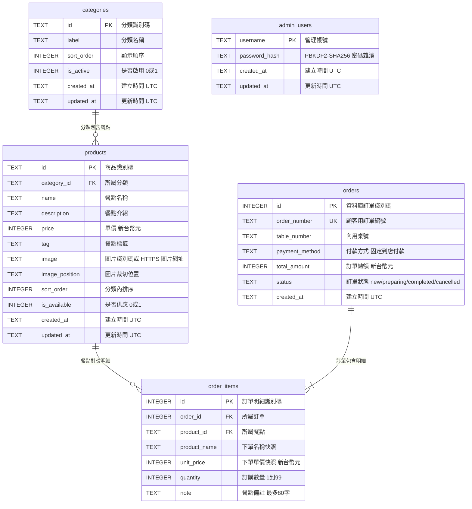

# 早餐店點餐後端 API 規格

## 目的

使用 Python FastAPI 提供早餐菜單、內用點餐及店家管理 API。菜單與正式訂單儲存於 SQLite，顧客端和管理頁透過同源 Web API 存取資料。

## 技術與檔案

- FastAPI 後端程式碼存放於專案根目錄 `src/`。
- SQLite 資料庫存放於專案根目錄 `data/breakfast.sqlite3`；首次啟動建立資料表及初始菜單。
- FastAPI 同時提供專案根目錄的前端頁面及靜態檔案，前端以同源相對路徑呼叫 `/api`。
- 從專案根目錄以 `uvicorn src.main:app --reload` 啟動開發伺服器。
- 安裝執行與測試依賴：`python -m pip install -r requirements.txt`；執行測試：`python -m unittest discover -s src -v`。
- SQLite 啟用外鍵限制；建立訂單及明細必須在同一交易中完成。
- 菜單金額及訂單金額使用新台幣整數元。
- 首次初始化資料庫時建立管理帳號，預設帳號為 `admin`、密碼為 `1234`；環境變數 `BREAKFAST_ADMIN_USERNAME` 和 `BREAKFAST_ADMIN_PASSWORD` 可提供首次帳號資料。帳號與密碼雜湊持久存入 SQLite；環境變數設為空字串時停用管理 API（回覆 503），已有資料庫帳號時環境變數不會覆寫帳密。

## ER 圖

圖檔：[database-er.jpg](database-er.jpg)；欄位與關係的文字版：[er.md](er.md)。



## 資料表與欄位

### categories

| 欄位 | 型態 | 限制 | 說明 |
|---|---|---|---|
| `id` | TEXT | PRIMARY KEY | 分類識別碼 |
| `label` | TEXT | NOT NULL | 前端顯示的分類名稱 |
| `sort_order` | INTEGER | NOT NULL DEFAULT 0 | 分類排序值 |
| `is_active` | INTEGER | NOT NULL DEFAULT 1, CHECK 0/1 | 是否顯示 |
| `created_at` | TEXT | NOT NULL | 建立時間，UTC ISO 8601 |
| `updated_at` | TEXT | NOT NULL | 更新時間，UTC ISO 8601 |

### products

| 欄位 | 型態 | 限制 | 說明 |
|---|---|---|---|
| `id` | TEXT | PRIMARY KEY | 商品識別碼，沿用前端穩定 ID |
| `category_id` | TEXT | NOT NULL, FK | 參照 `categories.id` |
| `name` | TEXT | NOT NULL | 商品名稱 |
| `description` | TEXT | NOT NULL DEFAULT '' | 商品簡介 |
| `price` | INTEGER | NOT NULL, CHECK >= 0 | 新台幣單價 |
| `tag` | TEXT | NOT NULL DEFAULT '' | 商品標籤 |
| `image` | TEXT | NOT NULL | 可存 Unsplash 圖片識別碼或 HTTPS 圖片網址；前端相容兩種格式 |
| `image_position` | TEXT | NOT NULL DEFAULT 'center' | 前端圖片裁切位置 |
| `sort_order` | INTEGER | NOT NULL DEFAULT 0 | 分類內排序值 |
| `is_available` | INTEGER | NOT NULL DEFAULT 1, CHECK 0/1 | 是否可點；停售以此欄位停用，不刪除商品 |
| `created_at` | TEXT | NOT NULL | 建立時間，UTC ISO 8601 |
| `updated_at` | TEXT | NOT NULL | 更新時間，UTC ISO 8601 |

### orders

| 欄位 | 型態 | 限制 | 說明 |
|---|---|---|---|
| `id` | INTEGER | PRIMARY KEY AUTOINCREMENT | 資料庫內部識別碼 |
| `order_number` | TEXT | NOT NULL UNIQUE | 回傳給顧客的訂單編號 |
| `table_number` | TEXT | NOT NULL, CHECK 長度 1–12 | 內用桌號 |
| `payment_method` | TEXT | NOT NULL, CHECK = `in_store` | 到店付款 |
| `total_amount` | INTEGER | NOT NULL, CHECK >= 0 | 伺服器計算的訂單總額 |
| `status` | TEXT | NOT NULL DEFAULT `new`, CHECK 狀態值 | 訂單處理狀態：`new`（新訂單）、`preparing`（製作中）、`completed`（已完成）、`cancelled`（已取消） |
| `created_at` | TEXT | NOT NULL | 建立時間，UTC ISO 8601 |

### order_items

| 欄位 | 型態 | 限制 | 說明 |
|---|---|---|---|
| `id` | INTEGER | PRIMARY KEY AUTOINCREMENT | 明細識別碼 |
| `order_id` | INTEGER | NOT NULL, FK | 參照 `orders.id`，刪除訂單時級聯刪除 |
| `product_id` | TEXT | NOT NULL, FK | 參照 `products.id`，限制刪除被訂購商品 |
| `product_name` | TEXT | NOT NULL | 下單時商品名稱快照 |
| `unit_price` | INTEGER | NOT NULL, CHECK >= 0 | 下單時新台幣單價快照 |
| `quantity` | INTEGER | NOT NULL, CHECK 1–99 | 訂購數量 |
| `note` | TEXT | NOT NULL DEFAULT '', CHECK 長度 <= 80 | 餐點備註 |

### admin_users

| 欄位 | 型態 | 限制 | 說明 |
|---|---|---|---|
| `username` | TEXT | PRIMARY KEY | 管理者帳號 |
| `password_hash` | TEXT | NOT NULL | PBKDF2-SHA256 雜湊（包含迭代次數與隨機 salt）；不保存明文密碼 |
| `created_at` | TEXT | NOT NULL | 建立時間，UTC ISO 8601 |
| `updated_at` | TEXT | NOT NULL | 更新時間，UTC ISO 8601 |

管理 session 使用簽章 cookie，不建立持久化 session 資料表；`admin_users` 與菜單及訂單表沒有外鍵關聯。

索引：`products(category_id, is_available, sort_order)`、`order_items(order_id)`、`orders(created_at)`；`orders.order_number` 以 UNIQUE 約束建立索引。

## API

### 1. 取得菜單

- 目的：取得目前啟用的分類及可供應商品。
- 路由：`/api/menu`
- 方法：GET
- 輸入：無
- 成功狀態：200
- 輸出：

```json
{
  "categories": [{ "id": "popular", "label": "人氣推薦" }],
  "products": [
    {
      "id": "chicken-toast",
      "category": "popular",
      "name": "香煎雞腿排蛋吐司",
      "description": "嫩煎雞腿排、滑蛋與生菜，經典早晨組合。",
      "price": 90,
      "tag": "人氣推薦",
      "image": "photo-1525351484163-7529414344d8",
      "imagePosition": "center 53%"
    }
  ]
}
```

- 僅回傳 `is_active = 1` 的分類及 `is_available = 1` 且所屬分類啟用的商品，依 `sort_order` 排序。
- 測試：初始菜單可取得；停用分類或商品不出現在回應；回應欄位與前端菜單契約一致。

### 2. 建立訂單

- 目的：驗證顧客送出的桌號及餐點，依資料庫菜單計價並將訂單與明細存入 SQLite。
- 路由：`/api/orders`
- 方法：POST
- 輸入：

```json
{
  "table": "A03",
  "items": [
    { "id": "chicken-toast", "quantity": 2, "note": "吐司不烤" }
  ]
}
```

- `table`：必填，去除前後空白後長度 1–12。
- `items`：必填，1–50 筆；每筆 `id` 為 1–64 字且必須存在並可供應，`quantity` 為 1–99 整數，`note` 最長 80 字。
- 客戶端不得傳送或指定品名、單價、付款方式、明細小計或訂單總額；伺服器依商品 ID 查詢資料庫並計算金額。
- 成功狀態：201；訂單及所有明細在單一資料庫交易中建立。
- 成功輸出：

```json
{
  "ok": true,
  "orderId": "ORD-20261106-A1B2C3",
  "table": "A03",
  "total": 180
}
```

- 錯誤狀態：422（欄位驗證失敗、空餐點、商品不存在或停售）；500 僅用於未預期伺服器錯誤。
- 測試：送出有效訂單後回傳訂單編號；檢查 SQLite 的訂單、明細及總額均正確。以不同備註與隨機桌號連續送出三次，三筆皆需成功且各自留存。無效請求不得留下部分訂單或明細。

## 店家管理 API

所有路由使用同源 `/api/admin` 前綴。除登入路由外，均須有有效管理 session；首次初始化時帳號預設為 `admin`、密碼為 `1234`，可用 `BREAKFAST_ADMIN_USERNAME`、`BREAKFAST_ADMIN_PASSWORD` 提供首次帳號資料。資料庫已有帳號時不會被環境變數覆寫；明確將任一變數設為空字串時管理功能回覆 503，不得匿名開放。登入成功以 8 小時有效的簽章 cookie 維持 session，設定 HttpOnly、SameSite=Strict，HTTPS 請求設定 Secure；寫入請求須驗證 Origin。密碼以 PBKDF2-SHA256 雜湊存於 SQLite，session 不存入 SQLite。

### 管理登入與登出

| 方法 | 路由 | 用途 |
|---|---|---|
| GET | `/api/admin/session` | 檢查目前 session；有效回覆 200 與 `{"authenticated": true}`，無效回覆 401 |
| POST | `/api/admin/session` | 驗證帳號與密碼並建立 session；憑證不正確回覆 401 |
| DELETE | `/api/admin/session` | 清除目前管理 session |

頁面路由規劃為 `GET /admin/login`（登入頁）及 `GET /admin`（管理主畫面）。管理主畫面載入後須呼叫 session 檢查；未登入或 session 失效時導回登入頁。頁面殼層不得內嵌或公開管理資料，所有管理 API 仍須獨立驗證。未登入的管理 API 回覆 401。

### 訂單管理

| 方法 | 路由 | 用途 |
|---|---|---|
| GET | `/api/admin/orders` | 依建立時間倒序列出訂單及明細，可用 `status` 篩選 |
| PATCH | `/api/admin/orders/{order_id}` | 更新訂單 `status`；只接受 `new`、`preparing`、`completed`、`cancelled` |

訂單清單需包含訂單編號、桌號、建立時間、付款方式、總額、狀態及明細快照（品名、下單單價、數量、備註）。訂單狀態不得改寫明細或金額。

### 分類與商品管理

管理端讀取須包含停用中的分類與停售商品；新增與更新欄位如下：

- 分類：`label`、`sort_order`、`is_active`。
- 商品：`category_id`、`name`、`description`、`price`、`tag`、`image`、`image_position`、`sort_order`、`is_available`。
- 商品及分類 ID 由伺服器產生且保持穩定；`created_at`、`updated_at` 由伺服器維護。價格為不小於零的新台幣整數；布林狀態限 0 或 1；排序為整數。
- 新設定的 `image` 必須是 HTTPS 圖片網址；既有 Unsplash 圖片識別碼仍須可顯示。此規格不包含上傳圖片檔。
- 不提供硬刪除。下架商品使用 `is_available = 0`，停用分類使用 `is_active = 0`，保留歷史訂單的外鍵及名稱/價格快照。

| 方法 | 路由 | 用途 |
|---|---|---|
| GET | `/api/admin/menu` | 取得所有分類與商品，包含停用項目 |
| POST | `/api/admin/categories` | 新增分類 |
| PATCH | `/api/admin/categories/{category_id}` | 更新分類名稱、排序或啟用狀態 |
| POST | `/api/admin/products` | 新增商品 |
| PATCH | `/api/admin/products/{product_id}` | 更新商品欄位或供應狀態 |

更新成功時刷新 `updated_at`。商品分類必須存在；未知欄位、無效價格、無效狀態或非 HTTPS 新圖片網址回覆 422。分類或商品 ID 不存在回覆 404。

## 資料庫遷移

`categories` 與 `products` 已含菜單維護所需欄位，不需新增菜單資料表。啟動時檢查 `orders` 欄位；若舊資料庫缺少 `status`，以 `ALTER TABLE` 增加 `TEXT NOT NULL DEFAULT 'new'` 並限制為四種狀態。建立 `admin_users` 表；若表中沒有帳號，使用環境變數或預設值建立第一筆帳號，密碼以 PBKDF2-SHA256 雜湊保存。遷移冪等且保留既有訂單與明細、既有管理帳號不會被重新初始化。

## 驗收

- FastAPI 程式碼位於 `src/`，SQLite 檔案位於 `data/breakfast.sqlite3`。
- 以 HTTP 開啟前端時，菜單由 `GET /api/menu` 載入，無 API 時顯示錯誤而非前端硬編碼菜單。
- `POST /api/orders` 以資料庫價格計算並原子寫入訂單及明細。
- 店家管理 API 使用預設帳密或環境變數覆寫；密碼設為空字串時停用。未登入請求不得取得或修改管理資料。
- ER 關聯、欄位型態與限制與資料模型規格一致；各已實作 API 均有自動化測試。