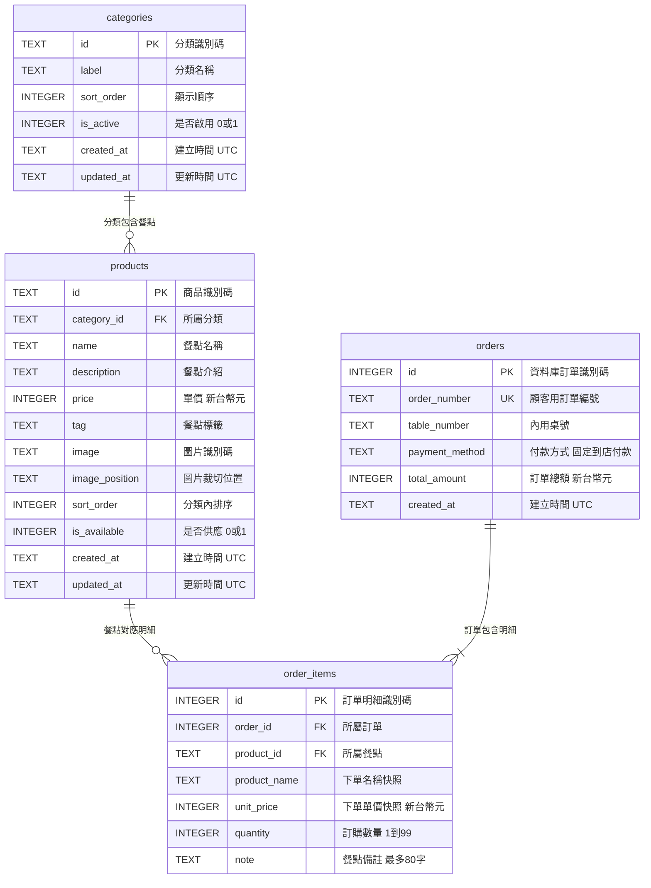

# 早餐店點餐後端 API 規格

## 目的

使用 Python FastAPI 提供早餐菜單及內用點餐 API。菜單與正式訂單儲存於 SQLite，前端透過同源 Web API 取得菜單及建立訂單。

## 技術與檔案

- FastAPI 後端程式碼存放於專案根目錄 `src/`。
- SQLite 資料庫存放於專案根目錄 `data/breakfast.sqlite3`；首次啟動建立資料表及初始菜單。
- FastAPI 同時提供專案根目錄的前端頁面及靜態檔案，前端以同源相對路徑呼叫 `/api`。
- 從專案根目錄以 `uvicorn src.main:app --reload` 啟動開發伺服器。
- 安裝執行與測試依賴：`python -m pip install -r requirements.txt`；執行測試：`python -m unittest discover -s src -v`。
- SQLite 啟用外鍵限制；建立訂單及明細必須在同一交易中完成。
- 菜單金額及訂單金額使用新台幣整數元。

## ER 圖

圖檔：[database-er.jpg](database-er.jpg)



## 資料表與欄位

### categories

| 欄位 | 型態 | 限制 | 說明 |
|---|---|---|---|
| `id` | TEXT | PRIMARY KEY | 分類識別碼 |
| `label` | TEXT | NOT NULL | 前端顯示的分類名稱 |
| `sort_order` | INTEGER | NOT NULL DEFAULT 0 | 分類排序值 |
| `is_active` | INTEGER | NOT NULL DEFAULT 1, CHECK 0/1 | 是否顯示 |
| `created_at` | TEXT | NOT NULL | 建立時間，UTC ISO 8601 |
| `updated_at` | TEXT | NOT NULL | 更新時間，UTC ISO 8601 |

### products

| 欄位 | 型態 | 限制 | 說明 |
|---|---|---|---|
| `id` | TEXT | PRIMARY KEY | 商品識別碼，沿用前端穩定 ID |
| `category_id` | TEXT | NOT NULL, FK | 參照 `categories.id` |
| `name` | TEXT | NOT NULL | 商品名稱 |
| `description` | TEXT | NOT NULL DEFAULT '' | 商品簡介 |
| `price` | INTEGER | NOT NULL, CHECK >= 0 | 新台幣單價 |
| `tag` | TEXT | NOT NULL DEFAULT '' | 商品標籤 |
| `image` | TEXT | NOT NULL | Unsplash 圖片識別碼 |
| `image_position` | TEXT | NOT NULL DEFAULT 'center' | 前端圖片裁切位置 |
| `sort_order` | INTEGER | NOT NULL DEFAULT 0 | 分類內排序值 |
| `is_available` | INTEGER | NOT NULL DEFAULT 1, CHECK 0/1 | 是否可點；停售以此欄位停用，不刪除商品 |
| `created_at` | TEXT | NOT NULL | 建立時間，UTC ISO 8601 |
| `updated_at` | TEXT | NOT NULL | 更新時間，UTC ISO 8601 |

### orders

| 欄位 | 型態 | 限制 | 說明 |
|---|---|---|---|
| `id` | INTEGER | PRIMARY KEY AUTOINCREMENT | 資料庫內部識別碼 |
| `order_number` | TEXT | NOT NULL UNIQUE | 回傳給顧客的訂單編號 |
| `table_number` | TEXT | NOT NULL, CHECK 長度 1–12 | 內用桌號 |
| `payment_method` | TEXT | NOT NULL, CHECK = `in_store` | 到店付款 |
| `total_amount` | INTEGER | NOT NULL, CHECK >= 0 | 伺服器計算的訂單總額 |
| `created_at` | TEXT | NOT NULL | 建立時間，UTC ISO 8601 |

### order_items

| 欄位 | 型態 | 限制 | 說明 |
|---|---|---|---|
| `id` | INTEGER | PRIMARY KEY AUTOINCREMENT | 明細識別碼 |
| `order_id` | INTEGER | NOT NULL, FK | 參照 `orders.id`，刪除訂單時級聯刪除 |
| `product_id` | TEXT | NOT NULL, FK | 參照 `products.id`，限制刪除被訂購商品 |
| `product_name` | TEXT | NOT NULL | 下單時商品名稱快照 |
| `unit_price` | INTEGER | NOT NULL, CHECK >= 0 | 下單時新台幣單價快照 |
| `quantity` | INTEGER | NOT NULL, CHECK 1–99 | 訂購數量 |
| `note` | TEXT | NOT NULL DEFAULT '', CHECK 長度 <= 80 | 餐點備註 |

索引：`products(category_id, is_available, sort_order)`、`order_items(order_id)`、`orders(created_at)`；`orders.order_number` 以 UNIQUE 約束建立索引。

## API

### 1. 取得菜單

- 目的：取得目前啟用的分類及可供應商品。
- 路由：`/api/menu`
- 方法：GET
- 輸入：無
- 成功狀態：200
- 輸出：

```json
{
  "categories": [{ "id": "popular", "label": "人氣推薦" }],
  "products": [
    {
      "id": "chicken-toast",
      "category": "popular",
      "name": "香煎雞腿排蛋吐司",
      "description": "嫩煎雞腿排、滑蛋與生菜，經典早晨組合。",
      "price": 90,
      "tag": "人氣推薦",
      "image": "photo-1525351484163-7529414344d8",
      "imagePosition": "center 53%"
    }
  ]
}
```

- 僅回傳 `is_active = 1` 的分類及 `is_available = 1` 且所屬分類啟用的商品，依 `sort_order` 排序。
- 測試：初始菜單可取得；停用分類或商品不出現在回應；回應欄位與前端菜單契約一致。

### 2. 建立訂單

- 目的：驗證顧客送出的桌號及餐點，依資料庫菜單計價並將訂單與明細存入 SQLite。
- 路由：`/api/orders`
- 方法：POST
- 輸入：

```json
{
  "table": "A03",
  "items": [
    { "id": "chicken-toast", "quantity": 2, "note": "吐司不烤" }
  ]
}
```

- `table`：必填，去除前後空白後長度 1–12。
- `items`：必填，1–50 筆；每筆 `id` 為 1–64 字且必須存在並可供應，`quantity` 為 1–99 整數，`note` 最長 80 字。
- 客戶端不得傳送或指定品名、單價、付款方式、明細小計或訂單總額；伺服器依商品 ID 查詢資料庫並計算金額。
- 成功狀態：201；訂單及所有明細在單一資料庫交易中建立。
- 成功輸出：

```json
{
  "ok": true,
  "orderId": "ORD-20261106-A1B2C3",
  "table": "A03",
  "total": 180
}
```

- 錯誤狀態：422（欄位驗證失敗、空餐點、商品不存在或停售）；500 僅用於未預期伺服器錯誤。
- 測試：送出有效訂單後回傳訂單編號；檢查 SQLite 的訂單、明細及總額均正確。以不同備註與隨機桌號連續送出三次，三筆皆需成功且各自留存。無效請求不得留下部分訂單或明細。

## 驗收

- FastAPI 程式碼位於 `src/`，SQLite 檔案位於 `data/breakfast.sqlite3`。
- 以 HTTP 開啟前端時，菜單由 `GET /api/menu` 載入，無 API 時顯示錯誤而非前端硬編碼菜單。
- `POST /api/orders` 以資料庫價格計算並原子寫入訂單及明細。
- ER 關聯、欄位型態與限制與程式資料表一致；各 API 均有自動化測試。