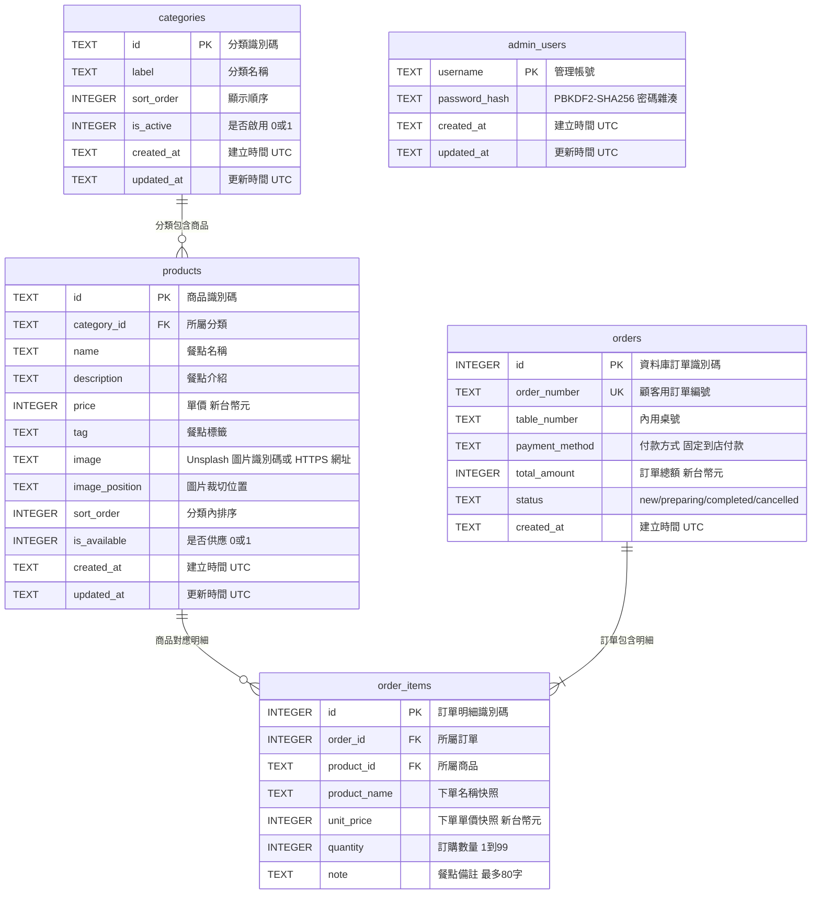

# 早餐店資料庫 ER 規格

本文件描述目前菜單/訂單資料模型。`orders.status` 已加入資料庫並在舊資料庫啟動時遷移；分類與商品管理沿用既有欄位，不新增資料表。

管理者登入首次初始化預設帳號為 `admin`、密碼為 `1234`，可由 `BREAKFAST_ADMIN_USERNAME`、`BREAKFAST_ADMIN_PASSWORD` 提供首次帳號資料；帳號與 PBKDF2-SHA256 密碼雜湊持久存入 `admin_users`。登入 session 使用 8 小時有效的簽章 cookie，不存入 SQLite。登入與管理 API 規格詳見 [backend.md](backend.md)。

圖檔：[database-er.jpg](database-er.jpg)。後端 API 與欄位限制詳見 [backend.md](backend.md)。

## 關聯與維護原則

- 一個分類可包含多個商品；商品必須參照一個分類。
- 一個訂單含一筆以上訂單明細；每筆明細參照一個商品。
- `order_items.product_name` 和 `unit_price` 是下單時快照；商品日後改名或改價不會改寫歷史訂單。
- 商品與分類以 `is_available = 0`、`is_active = 0` 停用，不硬刪除，以保留歷史訂單關聯。
- 分類、商品欄位已支援店家新增/編輯/停用功能，不需新增菜單資料表或欄位。
- `orders.status` 狀態為 `new`、`preparing`、`completed`、`cancelled`，預設 `new`；舊資料庫啟動時以非破壞性遷移新增欄位並保留既有訂單。
- `admin_users` 保存管理帳號及 PBKDF2-SHA256 密碼雜湊；session 僅由簽章 cookie 維持，不另建 session 資料表。
- `products.image` 可存 Unsplash 圖片識別碼或 HTTPS 圖片網址；前端相容兩種格式。新增商品圖片須使用 HTTPS；圖片上傳不在範圍內。